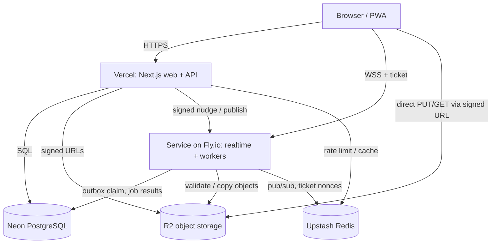

# Architecture Overview

## 1. Principles `[SPEC]` (spec §4.1–4.2)

- **Two authoritative stores:** PostgreSQL is authoritative for application data. S3-compatible object storage is authoritative for approved file bytes. Redis, workers and the realtime layer are disposable acceleration: losing them degrades speed, never correctness.
- **Modular monolith:** one codebase and one database, split into modules with enforced boundaries (see [modules.md](modules.md)).
- **Transactional outbox** for reliable background work (see [../database/background-jobs.md](../database/background-jobs.md)).

## 2. Deployment units

The spec defines four logical units (§4.2). ADR-0002 maps them onto two hosts.

| Logical unit `[SPEC]` | Runs on `[APPROVED preferred / PROPOSED details]` |
|---|---|
| Web layer (Next.js SSR, app shell, PWA) | Vercel (Next.js 16) |
| API layer (modular monolith: business logic, permissions, CRUD, signed URLs, outbox writes) | Vercel (Next.js route handlers / server actions) |
| Realtime layer (WebSocket, ticket auth, no DB access) | **Service** on Fly.io (candidate) |
| Background workers (Worker 1 files, Worker 2 jobs) | **Service** on Fly.io (candidate), same process or two processes |

Notes:
- `[SPEC]` The realtime layer does **not** access the database. It only authenticates tickets (Redis nonce) and relays events. The worker processes in the same service **do** access the database through module services. Keep this split visible in code: the realtime code path has no DB client import, enforced by a lint rule.
- File bytes never pass through Vercel functions (spec §4.6), which also avoids Vercel's 4.5 MB request-body limit.

## 3. Request flows

### 3.1 Authenticated HTTP request
Browser → Vercel. Session cookie → session validated against the DB (hashed token lookup, see the auth evaluation) → module service → permission check (per row) → response.

### 3.2 Mutation with background work (outbox)
Route handler → one DB transaction {domain write + outbox row} → commit → `after()` sends a signed **nudge** to the service → the worker claims outbox rows and processes them idempotently. The 5-minute sweep catches anything missed. See background-jobs.md.

### 3.3 Upload (spec §4.6)
Intent → asset `AWAITING_UPLOAD` + signed PUT URL (quarantine prefix) → browser uploads directly to R2 → complete → `UPLOADED` + outbox `file.uploaded` → worker `SCANNING` → magic bytes / MIME / size / SHA-256 → copy to published prefix + `APPROVED`, or `REJECTED`/`QUARANTINED` → notification.

### 3.4 Realtime (spec §4.8; ADR-0012)
Browser asks API for a ticket (30-s JWT, single-use nonce) → connects to service WSS → service verifies signature and consumes the nonce in Redis → subscribes the connection to permitted channels. On state change, the API commits, then publishes the event to the service. The service fans out to connected clients. Clients reconnect with backoff and **re-fetch authoritative state over HTTP** after reconnecting.

## 4. Cross-cutting concerns

| Concern | Approach | Doc |
|---|---|---|
| AuthN | Google OAuth (@thapar.edu), DB sessions, hashed token at rest (pending spike) | auth/authentication-evaluation.md |
| AuthZ | Global role (STUDENT/FACULTY/ADMIN) + per-row checks (society membership, ownership) | security/threat-model.md |
| Validation | Zod schemas at every API boundary; same schemas generate contract docs | api/README.md |
| Sanitisation | Server-side allow-list HTML sanitiser for rich text | security/threat-model.md |
| Audit | Append-only audit log for admin actions, claims, placement edits, moderation | database/database-design.md |
| Observability | Structured logs (Vercel Hobby keeps runtime logs only 1 hour → ship errors to an external sink, OI-40) | deployment/deployment-and-costs.md |
| Time | TIMESTAMPTZ stored in UTC; displayed in Asia/Kolkata | database/database-design.md |

## 5. Portability (NFR-PORT)
Vendor-specific code sits behind small adapters: `storage` (S3 API), `realtime-publisher`, `nudge`, `rate-limiter`, `cache`. Modules depend on the interfaces, not on Vercel/Fly/R2 SDKs directly. This keeps ADR-0002 reversible (e.g. moving to Option A: Vercel WebSockets).
