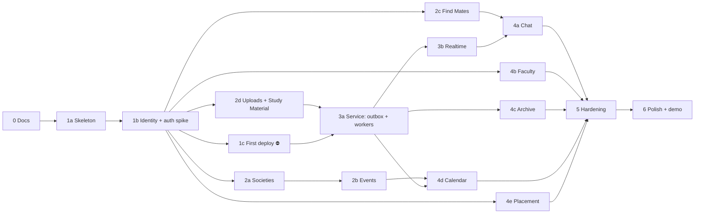

# Implementation Phases and Acceptance Criteria

Each slice ends with: CI green, docs updated (traceability, status, open issues, ADRs, API, DB), a phase report in `docs/status/phase-reports/`, screenshots for UI slices, then **owner approval** before the next slice starts. Slices marked ⛔ contain an approval gate for external actions.

## Dependency graph

## Slices and acceptance criteria

| Slice | Scope | Acceptance criteria (all automated unless noted) |
|---|---|---|
| **0** | Documentation only | All 31 FRs, NFRs, metrics, use-case steps and PLC-1…5 present in the traceability matrix. Every ADR has a status. Every gap-list item has a recommended default. Open issues have recommended defaults, alternatives, dependencies and the approvals needed. **Owner review.** |
| **1a** | `git init` (approval-gated), toolchain install, Next.js 16 + TypeScript 6 strict, lint/boundary rules, Vitest/Playwright/Testcontainers, Docker Postgres + Garage, CI (no deploy), static app shell in reference style, design tokens sampled | Boundary-violation fixture fails lint. Prerelease-dependency check passes. Shell renders at 1280/400 px (Playwright). Garage presigned PUT/HEAD/COPY/DELETE contract test passes. Tokens recorded in `frontend-design-rules.md` |
| **1b** | Auth spike (ADR-0005/0006) → owner review → Identity: FR-AUTH-1…4 (API), profile completion, CSRF, CSP (report-only → enforce), rate limiting, audit log, test-login provider, admin bootstrap | Spike: T01–T16 "Go". Then: domain matrix (T11); profile gate; revoke → 401; CSRF-missing → 403; 429 on limit; CSP and cookie attributes present; **production build fails if the test-login provider is included**. Real Google OAuth only after gate G-1b-oauth |
| **1c** ⛔ | Accounts/projects (Vercel, Neon, R2, Upstash, Fly), secrets, first preview + service health deploy | Gate G-1c approval with re-verified costs. Preview serves the shell; migrations apply; `/healthz` green; no secrets in the client bundle (scan); storage contract suite passes once against R2; Neon CU usage baseline recorded |
| **2a** | Societies: FR-SOC-1…4, sanitiser, permission helpers, admin create-society | Permission matrix unit tests. Cross-society 403. Story invisible after 24 h (fake clock). XSS corpus neutralised |
| **2b** | Events: FR-EVT-1,2,3,5 + EVT-4 toggle (HTTP); UC-07 steps 1–5, 7 | Illegal transitions → 422. **50 parallel registrations / 10 seats → exactly 10 REGISTERED + 40 WAITLISTED.** Duplicate → no new row. Cancelled event blocks registration (E3). UC-07 step 6 marked pending 3a |
| **2c** | Find Mates: FR-MATE-1,2,3,5 + accept/reject/connection; time-to-match capture; match scoring if OI-17 approved | UC-10 steps 1–7 + E1 + E2 (form restored after re-login). Concurrent last-spot accept never exceeds team_size. Expired requests hidden. MATE-4 remains Partial until 3a + 4a |
| **2d** | Upload intents/complete, asset state machine, Study Material FR-MAT-1,3,4 | Oversize / wrong type rejected **before** signed URL (E3). Every illegal asset transition rejected. Asset + outbox row atomic. One vote per student. Nothing listed before APPROVED |
| **3a** | Service: outbox claim/lease/retry, nudge + 5-min sweep, file validation (magic bytes, MIME, size, SHA-256), notifications (in-app), scheduled jobs; Neon CU measurement | Valid PDF approved; renamed executable rejected; **SHA-256 mismatch rejected**; crash mid-handler recovers via lease; duplicate delivery → single effect; lost nudge processed by sweep; DEAD after 8; rejection reason notified (UC-13 E2); normal-path latency **measured and reported** (MET-3 target, not asserted as a guarantee); CU usage reported for OI-06 |
| **3b** | Tickets, WSS, Redis (TCP SUBSCRIBE spike), live interest counts + notifications | Ticket reuse/expiry rejected. Unauthorised channel subscribe rejected. Two-browser live count (FR-EVT-4 complete). Forced disconnect → reconnect + HTTP re-sync |
| **4a** | Chat per MateConnection | Outsider 403 (IDOR). Messages persist; sanitised; delivered live; re-sync after reconnect. ACT-1…9 E2E passes → MATE-4 Complete |
| **4b** | Faculty directory, FTS + pg_trgm, claims with admin approval (ADR-0010) | "Kumr" finds "Kumar". Search < 100 ms on 500 seeded profiles (measured). Claim stays PENDING until admin decision. Non-admin cannot decide. Approval revokes sessions + sets role; audit row |
| **4c** | Archive FR-ARC-1…3, review queue, screenshots, comments depth ≤ 3; voting per OI-22 | Unreviewed hidden. Depth 4 rejected. Comments sanitised. Screenshots only via approved assets |
| **4d** | Calendar FR-CAL-1…3, expansion worker, export | RRULE edge cases (DST-free IST, month-end, COUNT/UNTIL). Window ≥ 90 days after job. `.ics` parses with an independent library. Society events appear in the society layer |
| **4e** | Placement PLC-1…5 | Tests in `requirements/placement-matrix.md` §5 |
| **5** | Hardening: OWASP Top 10:2025 review, IDOR generator, admin dashboard consolidation (users, sessions, moderation, claims, DEAD outbox, audit log), load test, accessibility | Every route covered by authz tests. k6: p95 < 200 ms at 200 VUs (environment documented). axe: no serious/critical. Dependency audit clean. Security review report |
| **6** | PWA (Serwist), metrics dashboard (time-to-match), content seeding, demo prep, final docs | Lighthouse installability. Metric query unit-tested. OBJ-1 seeds (≥3 societies, ≥5 events). All traceability rows Complete or explicitly approved otherwise |

## Approval gates
| Gate | Before | Requires |
|---|---|---|
| G-0 | Slice 1a | Owner approves Phase 0 docs and the decisions in `open-issues.md` §1 |
| G-1a-git | `git init`, first install | Owner approval at start of 1a |
| G-1b-spike | Production use of auth | Owner reviews `auth/spike-findings.md` (ADR-0005/0006) |
| G-1b-oauth | Creating a Google Cloud OAuth client | Owner approval + OI-01 confirmed |
| G-1c | Any external account, infrastructure, secret, or deployment | Owner approval + re-verified cost table |
| G-each | Every slice | Phase report reviewed and approved |
